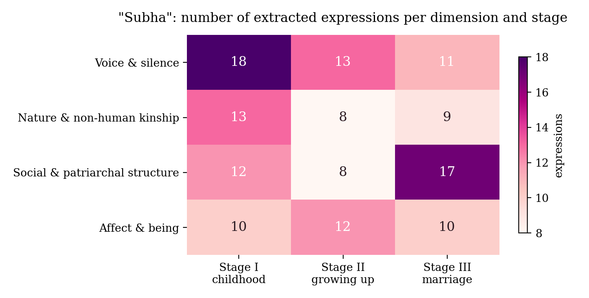
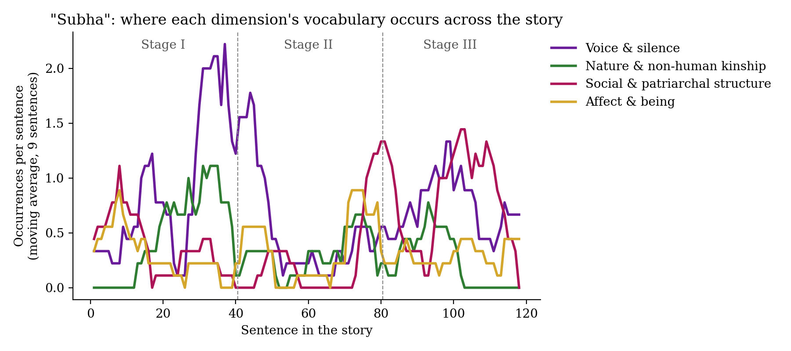

# Interpretation — Tagore's "Subha"

*Step 7 of the synthetic reading. Draft: Khushi to revise in her own voice before presenting.*

## Statement tested

From the initial impression: **across the three stages of the story, Subha's language moves from being understood by a non-human community to being unheard altogether, and the vocabulary of nature and kinship gives way to the vocabulary of social and patriarchal structure.**

## What the visualisations show

1. **Voice and nature rise together in Stage I.** The two curves peak at the same place (around sentences 28–40). This is the passage where "the murmur of the brook, the voice of the village folk, the songs of the boatmen, the crying of the birds and rustle of trees mingled and were one with the trembling of her heart", and where "there were only dumb Nature and a dumb girl". The vocabulary of speech is densest where the human world falls silent and the non-human one speaks.
2. **Stage II is quiet, then social structure surges.** Overall density drops while Subha's companions are animals and the speaking boy Pratap, with whom she has "no common language". Then two spikes arrive almost together. First is affect: the full-moon night of "inexpressible consciousness" and "illimitable loneliness". Then social structure, the moment "the thought of her marriage" appears and "people blamed them, and even talked of making them outcasts".
3. **In Stage III nature comes back once, as farewell, and then disappears.** The green line rises once more (sentences 88–100) as Subha says goodbye to the cows, her "dear river" and "earth, her strong silent mother". From about sentence 103 to the end, the Calcutta section, it falls to **zero**. Social structure reaches its highest point there: her mother "dressed her up with great care", "imprisoned her hair" and "did her best to kill her natural beauty" with ornaments, and she is inspected, valued and "delivered over… into another's hands".
4. **Voice never disappears, but it changes channel.** In Stage III, "voice" means *tears, gaze, weeping, "not a word did they vouchsafe"*. It's all non-verbal, and none of it is received.

**Verdict.** The statement is **largely supported, with a correction.** Nature does not fade gradually. It stays present until Subha is physically taken away from Chandipur, then vanishes all at once. The loss is a matter of place, not of time: marriage removes her from the only community that could hear her.

## Reading the results through theory

**Spivak: the subaltern cannot be heard.** In "Can the Subaltern Speak?" (1988), Spivak argues that the subaltern woman's problem is not an inability to speak. It is the absence of any structure in which her speech can be heard. Tagore makes this literal: Subha "deceived no one. Her eyes told them everything, though no one understood her." The family's premise that "because she did not speak, therefore she did not feel" is *epistemic violence*: it decides in advance what counts as knowledge of her inner life. The ending, where only "the Searcher of Hearts could hear", confirms that no human listener is left.

**The traffic in women.** The Stage III structure vocabulary is commercial: "useful possession", "only increased her value", "put it to her credit in the account", "delivered over… into another's hands". Gayle Rubin's "The Traffic in Women" (1975) describes marriage as an exchange between men in which the woman is the object passed along. The bride-viewing reverses the gaze of Stage I: Subha, whose eyes were her language, becomes the one who is "scanned" by "the great man". Tagore's own irony names the exchange as ritual violence: the parents watch "the god arrive to select the beast for his sacrifice".

**Ecofeminism, which cuts both ways.** Val Plumwood (*Feminism and the Mastery of Nature*, 1993) shows how Western dualisms put woman and nature together on the side of the "dumb", against reason and speech. The story does align Subha with "dumb Nature". It also revalues that side: the cows "understood her gentle murmuring better than all speech". Yet the same alignment naturalises her capture. In Stage III she follows her parents "like a dumb animal" and looks at them as "a stricken doe looks in the hunter's face". The kinship with nature that sustained her becomes the image of her as prey.

**Disability and the marriage market.** Rosemarie Garland-Thomson's figure of the *normate* (*Extraordinary Bodies*, 1997) helps explain why Subha's muteness is first called a "deformity" in her mother and then hidden at the wedding. Her disability is not a medical fact in the story. It is a fall in exchange value that the family has to conceal.

## Limitations and reflexivity

- The story is read in an anonymous 1918 English translation, not Tagore's Bengali. Word-level findings describe the translation.
- Counts are small (141 expressions in about 2,250 words). The charts show tendencies, not statistical proof.
- The categories were defined by the researcher, the 7B model's extraction was incomplete and sometimes wrong, and the lists were then curated by the author (see the notes in `Subha_Themes.py`). The research question shapes what is found.
- The first, failed extraction run is kept in `results/first_run_whole_stages.json` for transparency.

## Works cited

- Tagore, Rabindranath. "Subha." *Stories from Tagore*. New York: Macmillan, 1918. Project Gutenberg eBook #33525.
- Spivak, Gayatri Chakravorty. "Can the Subaltern Speak?" *Marxism and the Interpretation of Culture*, edited by Cary Nelson and Lawrence Grossberg, University of Illinois Press, 1988, pp. 271–313.
- Rubin, Gayle. "The Traffic in Women: Notes on the 'Political Economy' of Sex." *Toward an Anthropology of Women*, edited by Rayna R. Reiter, Monthly Review Press, 1975, pp. 157–210.
- Plumwood, Val. *Feminism and the Mastery of Nature*. Routledge, 1993.
- Garland-Thomson, Rosemarie. *Extraordinary Bodies: Figuring Physical Disability in American Culture and Literature*. Columbia University Press, 1997.
- Ghosh, Sourav, and Shanmugapriya T. Article on synthetic reading, *International Journal of Humanities and Arts Computing*, 2026, https://doi.org/10.3366/ijhac.2026.0378. *[Khushi: add the exact article title from the PDF.]*
