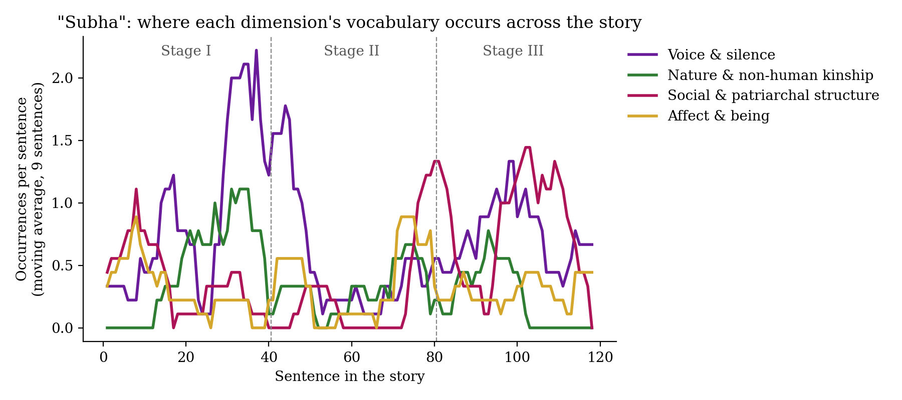

# Assignment 03: Synthetic Reading of Tagore's "Subha"

The synthetic-reading method of Ghosh, Shanmugapriya T and Mandal (*IJHAC* 20.2, 2026) applied to Rabindranath Tagore's "Subha" (*Stories from Tagore*, 1918).

| Step | File |
|---|---|
| 1. Partial reading (20% of each third) | [partial_reading.py](partial_reading.py), [partial_reading.txt](partial_reading.txt) |
| 2. Research problem, positionality, frameworks | [initial_impression.md](initial_impression.md) |
| 3. Full text | [subha.txt](subha.txt) |
| 4. Prompt for the local LLM | [prompt.txt](prompt.txt) |
| 5. LLM extraction and author-annotated themes | [extract_themes.py](extract_themes.py), [subha_themes.py](subha_themes.py) |
| 6. Visualisation | [visualise.py](visualise.py), [figures/](figures/) |
| 7. Interpretation | [interpretation.md](interpretation.md) |

---

**Khushi Jha** · MA Digital Humanities · Department of Humanities and Social Sciences, IIT (ISM) Dhanbad · Monsoon Semester 2026
Portfolio: https://jha-khushi.github.io/digital-humanities-website/
