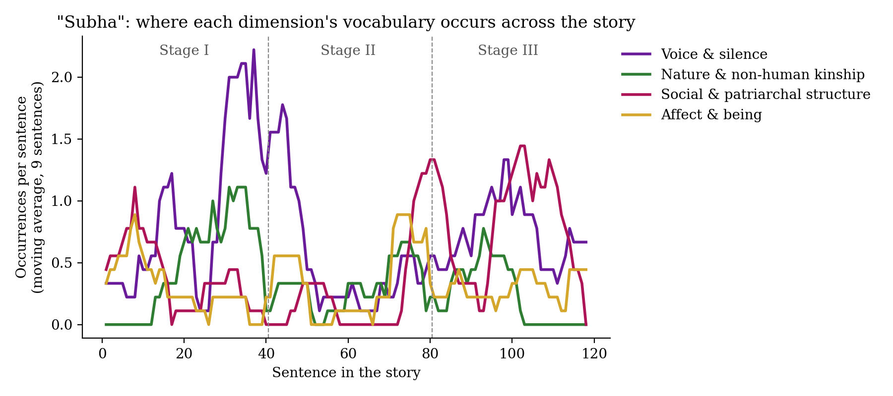
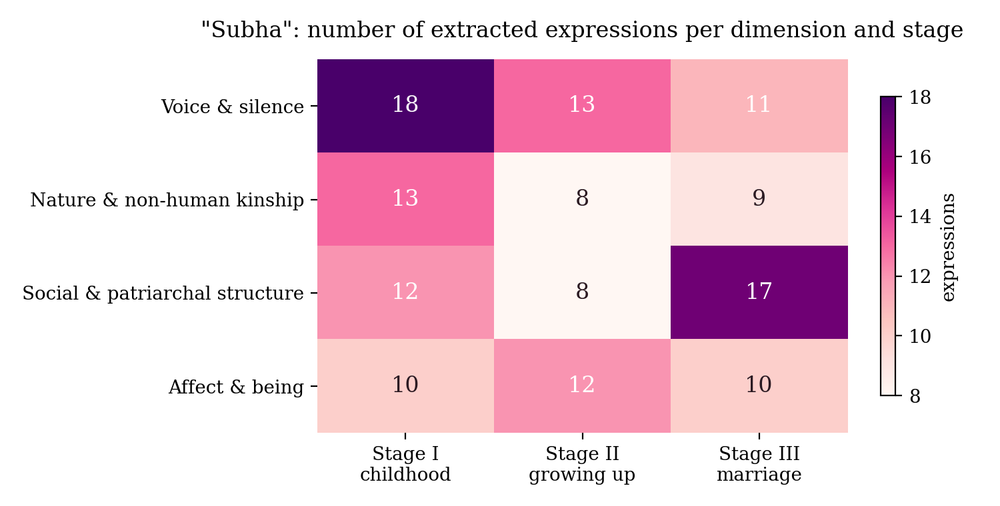

# Interpretation — Tagore's "Subha"

*Step 7 of the synthetic reading: interpreting the results.*

## What I set out to test

After reading only 20% of the story, I thought "Subha" was about who gets counted as a feeling person. Subha cannot speak, so the people around her decide that she cannot feel either. My guess was that her language does not disappear; it moves to the non-human world, and marriage then takes her away from it. So my statement was:

> **Across the three stages of the story, Subha's language moves from being understood by a non-human community to being unheard altogether, and the vocabulary of nature gives way to the vocabulary of social and patriarchal structure.**

## What the charts show

**1. Voice and nature peak together in Stage I.** The purple and green lines rise at the same point (around sentences 28–40). This is the passage where "the murmur of the brook, the voice of the village folk, the songs of the boatmen, the crying of the birds and rustle of trees mingled and were one with the trembling of her heart", and where "there were only dumb Nature and a dumb girl". The story uses the most language about speaking exactly where the humans fall silent and nature takes over. I read this as Tagore giving Subha a listener after all: the world around her.

**2. Stage II is quiet until marriage enters.** While Subha's companions are the cows, a kitten and Pratap (who "could speak, and his gift of speech left them without any common language"), the lines stay low. Then two spikes come almost together. First is affect, on the full-moon night of "inexpressible consciousness" and "illimitable loneliness". Then social structure, the moment "the thought of her marriage" appears and "people blamed them, and even talked of making them outcasts". The community's voice enters the story as blame.

**3. In Stage III nature returns once, to say goodbye, and then vanishes.** The green line rises one last time (sentences 88–100) as Subha takes leave of the cows, her "dear river" and "earth, her strong silent mother". From about sentence 103, the Calcutta section, it falls to **zero** and never comes back. In the same place the social-structure line reaches its highest point: her mother "dressed her up with great care", "imprisoned her hair", and "did her best to kill her natural beauty" with ornaments, and Subha is inspected, valued and "delivered over… into another's hands".

**4. Her voice never disappears, but it changes channel.** In Stage III, "voice" means tears, gaze and weeping, and "not a word did they vouchsafe". All of it is non-verbal, and none of it is received.

**My verdict:** the statement is **largely supported, with one correction.** I expected nature to fade gradually. It does not. It stays as long as Subha is in Chandipur and then disappears all at once when she is taken away. What she loses is a matter of place, not of time: marriage removes her from the only community that could hear her.

## Reading this with theory

**Spivak: not speaking versus not being heard.** In "Can the Subaltern Speak?" (1988), Gayatri Chakravorty Spivak argues that the subaltern woman's problem is not that she cannot speak. It is that there is no structure in which her speech can be heard. "Subha" makes this almost literal. Subha "deceived no one. Her eyes told them everything, though no one understood her." The family's belief that "because she did not speak, therefore she did not feel" is what Spivak calls *epistemic violence*: a decision made in advance about what counts as knowledge of someone's inner life. At the end, only "the Searcher of Hearts" can hear her, which tells us that no human listener is left.

**The traffic in women.** The words that dominate Stage III come from trade: "useful possession", "only increased her value", "put it to her credit in the account", "delivered over… into another's hands". Gayle Rubin's "The Traffic in Women" (1975) describes marriage as an exchange between families in which the woman is the thing exchanged. The bride-viewing scene also reverses the gaze of Stage I. Subha, whose eyes were her language, now becomes the one who is "scanned" by "the great man". Tagore's own irony names what is happening: the parents watch "the god arrive to select the beast for his sacrifice".

**Ecofeminism, which cuts both ways.** Val Plumwood (*Feminism and the Mastery of Nature*, 1993) shows how Western thought puts woman and nature together on the side of the "dumb", opposed to reason and speech. The story does put Subha beside "dumb Nature", but it also values that side: her cows "understood her gentle murmuring better than all speech". The same closeness to nature, however, is used to describe her capture. In Stage III she follows her parents "like a dumb animal" and looks at them as "a stricken doe looks in the hunter's face". The bond that sustained her becomes the image of her as prey.

**Disability and the marriage market.** Rosemarie Garland-Thomson's idea of the *normate* (*Extraordinary Bodies*, 1997) helps me see why Subha's muteness is first described as a "deformity" in her mother and then hidden at the wedding. In the story her disability is less a medical fact than a loss of value in the marriage market, which the family has to conceal.

## Limitations

- I read an anonymous 1918 English translation, not Tagore's Bengali, so my word-level findings describe the translation.
- The numbers are small (141 expressions in about 2,250 words). The charts show tendencies, not statistical proof.
- I defined the four categories myself, the 7B model's extraction was incomplete and sometimes wrong, and I then curated the lists (every change is noted in `subha_themes.py`). My research question shaped what was found, which is exactly what the synthetic-reading method asks the reader to acknowledge.
- The first extraction run failed (the model began copying the text word by word). I kept it in `results/first_run_whole_stages.json` for transparency.

## Works cited

- Tagore, Rabindranath. "Subha." *Stories from Tagore*. New York: Macmillan, 1918. Project Gutenberg eBook #33525.
- Ghosh, Sourav, Shanmugapriya T, and Sanatan Mandal. "Synthetic Reading: Towards a Hermeneutic-Computational Method for Literary Interpretation through Tagore's 'A Wife's Letter'." *International Journal of Humanities and Arts Computing*, vol. 20, no. 2, 2026, pp. 216–237, https://doi.org/10.3366/ijhac.2026.0378.
- Spivak, Gayatri Chakravorty. "Can the Subaltern Speak?" *Marxism and the Interpretation of Culture*, edited by Cary Nelson and Lawrence Grossberg, University of Illinois Press, 1988, pp. 271–313.
- Rubin, Gayle. "The Traffic in Women: Notes on the 'Political Economy' of Sex." *Toward an Anthropology of Women*, edited by Rayna R. Reiter, Monthly Review Press, 1975, pp. 157–210.
- Plumwood, Val. *Feminism and the Mastery of Nature*. Routledge, 1993.
- Garland-Thomson, Rosemarie. *Extraordinary Bodies: Figuring Physical Disability in American Culture and Literature*. Columbia University Press, 1997.
