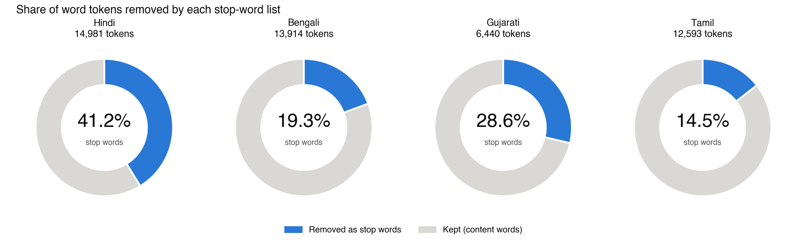

# Assignment 05 (additional): Testing the Indic Stop-Word Lists on Real Text

An extension of [dh-01-indic-stopwords](https://github.com/jha-khushi/dh-01-indic-stopwords). The four lists (copied in `stopword_lists/`) are applied to comparable texts: the same four Wikipedia articles (India, Rabindranath Tagore, Monsoon, Ganges) in Hindi, Bengali, Gujarati and Tamil.

**Main finding:** the Hindi list removes 41.2% of all tokens but the Tamil list only 14.5%, because Tamil (and largely Bengali) joins case endings to the noun, where a whitespace-based list cannot reach them. See [findings.md](findings.md).



```bash
pip install matplotlib && python evaluate_stopwords.py
```

Texts: Wikipedia contributors, CC BY-SA 4.0 (sources at the top of each file in `texts/`).

---

**Khushi Jha** · MA Digital Humanities · Department of Humanities and Social Sciences, IIT (ISM) Dhanbad · Monsoon Semester 2026
Portfolio: https://jha-khushi.github.io/digital-humanities-website/
