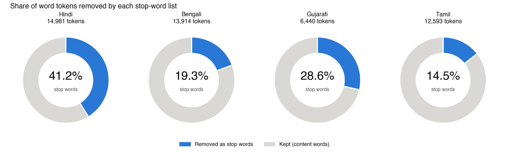
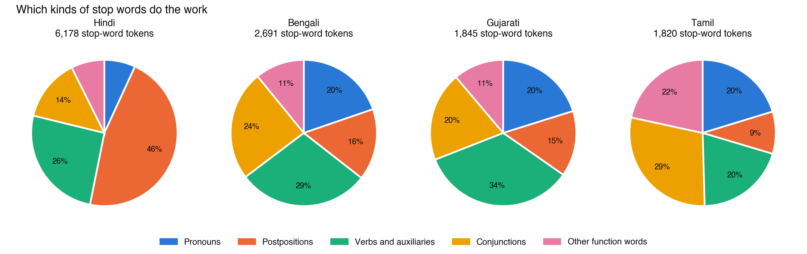
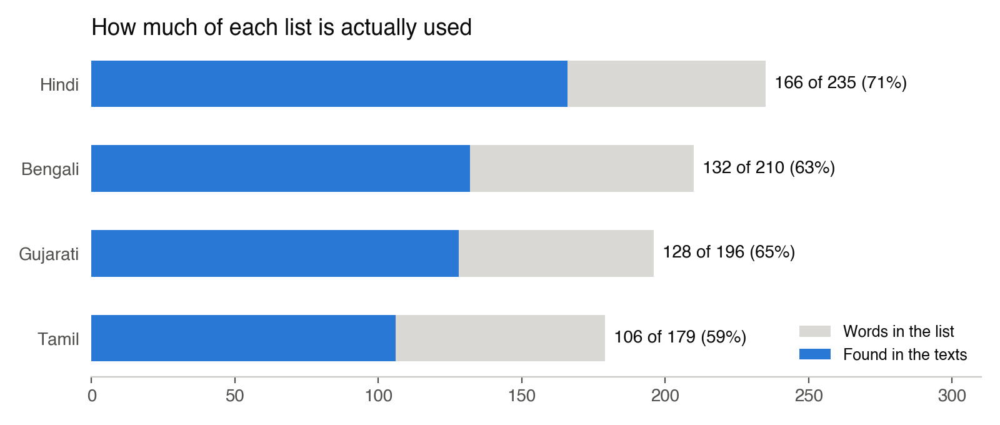

# Findings: Testing the Indic Stop-Word Lists on Real Text

*Extension of Assignment 01. Script: `evaluate_stopwords.py`. Data: `results/coverage.json`, `results/top_words.md`.*

## Question

A stop-word list is usually judged by looking at it. I wanted to test the four lists I made for Assignment 01 by using them. How much of a real text does each list remove, which kinds of words do the work, and what do the lists miss?

## Texts

To compare languages fairly, I needed texts on the same subjects. I used the same four Wikipedia articles in Hindi, Bengali, Gujarati and Tamil: *India*, *Rabindranath Tagore*, *Monsoon* and *Ganges* (16 articles, CC BY-SA 4.0; sources are listed at the top of each file in `texts/`). They are not translations of one another, and the Gujarati articles are shorter (6,440 tokens against 12,600–15,000 for the others). Tokens are runs of Indic letters, so numbers, dandas and Latin script are left out.

## Results

| Language | Tokens | Removed by the list | Share of tokens | Words of the list found in the texts |
|---|---|---|---|---|
| Hindi | 14,981 | 6,178 | **41.2%** | 166 of 235 (71%) |
| Gujarati | 6,440 | 1,845 | **28.6%** | 128 of 196 (65%) |
| Bengali | 13,914 | 2,691 | **19.3%** | 132 of 210 (63%) |
| Tamil | 12,593 | 1,820 | **14.5%** | 106 of 179 (59%) |

**1. The same kind of list does very different work in different languages.** The Hindi list removes 41% of all tokens, but the Tamil list removes only 14.5%. The lists are of similar size, so the gap does not come from list length. It comes from how each language writes its grammar.

**2. Hindi writes its grammar as separate words; Tamil and Bengali join it to the noun.** In Hindi, postpositions alone account for 46% of the stop words removed (के 691, में 668, की 362, से 293). The equivalent meanings in the other languages are mostly endings joined to the noun, which a whitespace-based list cannot touch:

- Bengali: ভারতের ("of India", 107), ভারতে ("in India", 49), গঙ্গার ("of the Ganges", 53).
- Tamil: இந்தியாவின் ("of India", 95), இந்தியாவில் ("in India", 40), உலகின் ("of the world", 32).
- Gujarati: ભારતની ("of India", 19), ભારતમાં ("in India", 18), and the author's name with endings (ટાગોરે, ટાગોરની, ટાગોરના).

Postpositions therefore do only 9% of the work in Tamil and 15–16% in Bengali and Gujarati. Gujarati sits in the middle, because some case markers (માં, પર) are written separately and many are joined.

**3. What the lists should add.** The most frequent words that the lists did not remove point to real gaps:
- Hindi: the passive auxiliary जाता (50), and जाती and जाते with it.
- Bengali: সালে ("in the year", 112).
- Gujarati: તરીકે ("as", 24), દરમિયાન ("during", 19), રીતે ("in the manner", 19), and the joined relatives જેમાં ("in which", 23) and તેમાં ("in that", 21).
- Tamil: இல் (67), which is the locative ending written after numbers (e.g. "1947-இல்"), and ஆகியவை ("and so on", 31).

**4. A word's function depends on its context.** In my Tamil list, ஆம் is listed as "yes". In these texts it occurs 132 times, almost always as the ordinal marker in dates ("1947 ஆம் ஆண்டு", "the year 1947"). It is still a function word, but not the one I expected. Tamil பொ and ஊ (33 each) are the two halves of the abbreviation பொ.ஊ. ("Common Era"), which my tokeniser split at the full stop.

**5. About a third of each list never appeared.** Between 59% and 71% of each list occurred in the texts. Most of the unused words are colloquial or first- and second-person forms (Hindi तू, तेरा; Bengali তুই, তোর). Encyclopaedia prose rarely uses them, but fiction and dialogue would. So the right list depends on the genre.

## Conclusion

A stop-word list is not language-neutral. It assumes that grammar is written as separate words. That assumption suits Hindi and fails for agglutinative Tamil. For Tamil and Bengali, and partly for Gujarati, removing grammar needs a stemmer or morphological analyser, not a longer list. For digital humanities, this means a pre-processing step that looks technical has a language politics: tools built around Hindi or English quietly work better for some Indian languages than for others.

## Limitations

- These are encyclopaedia texts, not literary ones, and the Gujarati sample is about half the size of the others.
- The articles are comparable in subject, not parallel translations.
- Category shares depend on how I grouped the words in my own lists.
