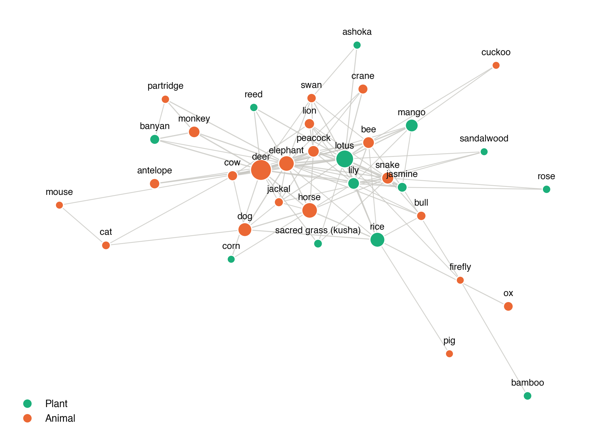

# Assignment 06 (additional): Comparing the Natural Worlds of Five Books

An extension of [dh-02-rag-flora-fauna](https://github.com/jha-khushi/dh-02-rag-flora-fauna). The RAG step found **which** plants and animals the five books name. This script counts **how often** each is mentioned in the full text of every book, and compares the books: plants versus animals, categories, names shared or unique, and a co-occurrence network. Names that are also common English words ("bear", "rose") are counted only in animal or plant contexts.

Results: [results/summary.md](results/summary.md) · [results/mentions.json](results/mentions.json) · [figures/](figures/)



```bash
git clone https://github.com/jha-khushi/dh-02-rag-flora-fauna ../dh-02-rag-flora-fauna
pip install numpy matplotlib networkx && python compare_books.py
```

---

**Khushi Jha** · MA Digital Humanities · Department of Humanities and Social Sciences, IIT (ISM) Dhanbad · Monsoon Semester 2026
Portfolio: https://jha-khushi.github.io/digital-humanities-website/
