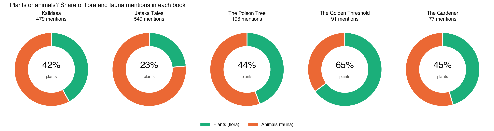
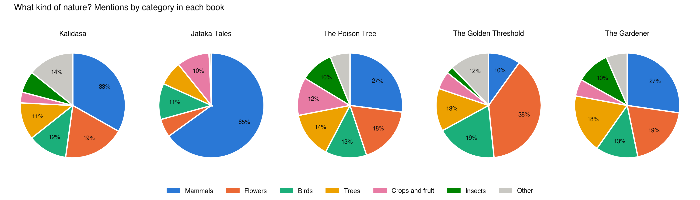
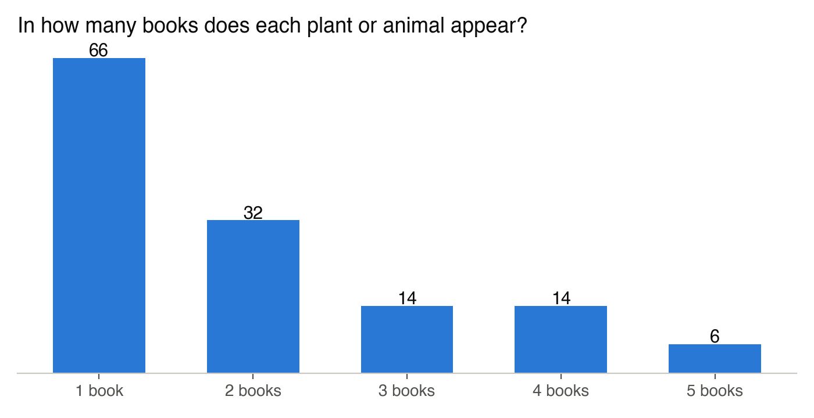
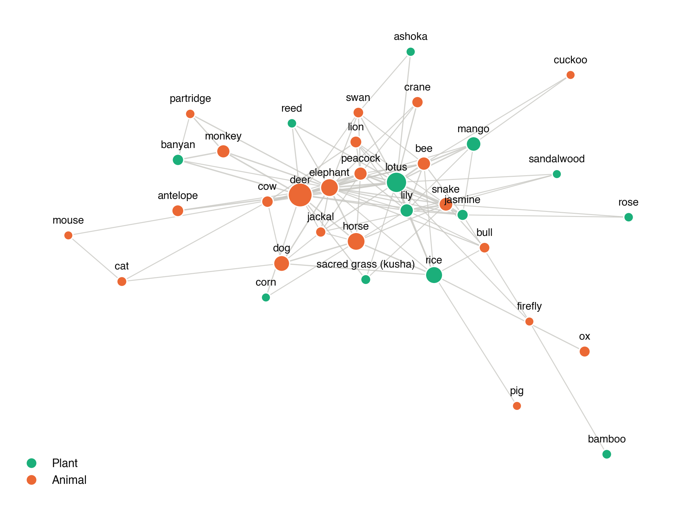

# Findings: The Natural Worlds of Five Indian Books

*Additional assignment extending Assignment 02. Script: `compare_books.py`. Data: `results/summary.md`, `results/mentions.json`.*

## Question

The RAG pipeline in Assignment 02 found **which** plants and animals five Indian books name: 65 plants and 68 animals. Here I asked **how often** each book names them, and whether each book has its own natural world.

## Method

For each of the 133 validated names (with the variants it was merged from), I counted every mention in the full text of each book, not only in the retrieved passages. Passages overlap, so only the non-overlapping part of each passage was counted. Some names are also common English words or names of characters, and for these only plant or animal contexts were counted:

- "bear": Naidu's "we **bear** her along" is a verb, and a first count wrongly gave her poems six bears;
- "rose" (the past tense of "rise"), "sandal" (footwear), "palm" (the hand);
- "kunda": in *The Poison Tree*, **Kunda** (Kunda Nandini) is the heroine. Her name is a white jasmine, and Bankim plays on it ("what if you should discover the flower, Kunda, under the trees?"). A naive count found the "flower" 400 times.

## Results

| Book | Words | Mentions | Per 1,000 words | Distinct names | Plants : animals |
|---|---|---|---|---|---|
| Kalidasa | 55,262 | 479 | 8.7 | 69 | 42 : 58 |
| Jataka Tales | 48,975 | 549 | 11.2 | 40 | 23 : 77 |
| The Poison Tree | 45,600 | 196 | 4.3 | 64 | 44 : 56 |
| The Golden Threshold | 5,358 | 91 | **17.0** | 47 | 65 : 35 |
| The Gardener | 13,132 | 77 | 5.9 | 38 | 45 : 55 |

**1. Each genre has its own nature.**
- **Jataka Tales:** the animal fables are 77% animals, and mammals alone make up 65% of their mentions: deer (111), horse, dog, elephant and monkey. Animals are the characters, and the Bodhisatta is born as a deer, a quail or a monkey.
- **Sarojini Naidu:** her poems are the only book dominated by plants (65%), and flowers are 38% of all mentions: lotus, henna, rose, poppy, champa, jasmine. She also has by far the densest natural vocabulary, 17 mentions per 1,000 words.
- **Bankim's novel:** the least dense (4.3). Its realist household world is full of small domestic animals that no other book has: owls, sparrows, lizards, rats and cats.
- **Kalidasa:** balanced, and his distinctive names are ritual and courtly ones: sacred kusha grass, the spring creeper, amaranth.

**2. A small shared core.** Only six names occur in all five books: **deer, lotus, mango, peacock, rice and snake**. Of 132 names counted, 66 occur in only one book.

**3. The lotus is the centre.** In the co-occurrence network (two names are linked if they share a passage at least twice), the most connected names are the lotus, elephant and deer. Around the lotus cluster the bee, the swan, the lily and jasmine: the conventional imagery of Indian poetry. The forest animals of the Jatakas (antelope, monkey, partridge and banyan) form their own group.

## Conclusion

The same method, applied to five books, shows five different natural worlds shaped by genre: the fable's animals, the lyric's flowers, the novel's household creatures and the court poet's ritual plants. It also shows the limits of counting words. A name can be a verb, a pun or a heroine, and "Kunda" is the clearest case: the flower and the woman are the same word, which is exactly the kind of meaning that close reading has to supply.

## Limitations

- All five books are read in English, and four are translations, so the names are partly the translators' choices.
- The list of names comes from the RAG step, so a plant or animal the RAG step missed is not counted here.
- The book lengths differ widely (5,358 to 55,262 words), so densities are compared per 1,000 words.
